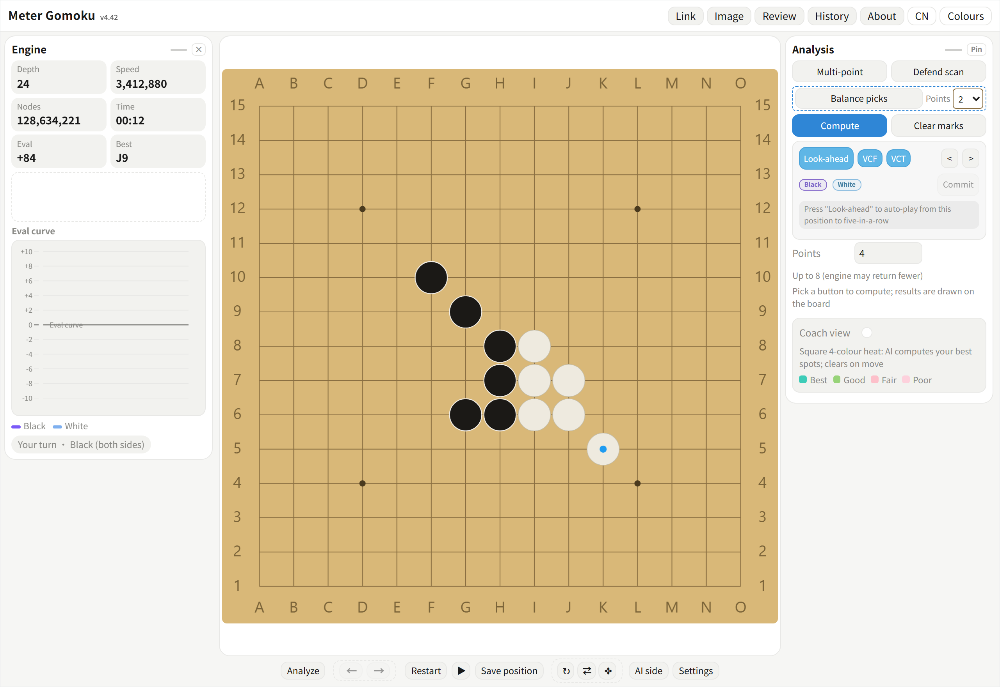
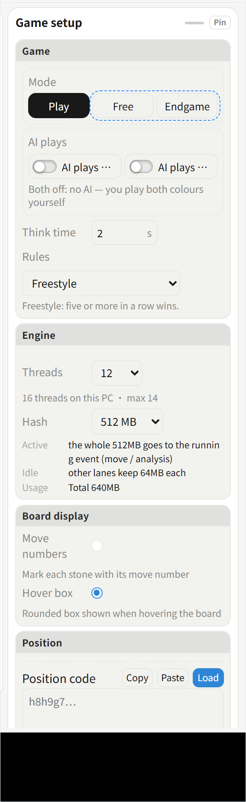
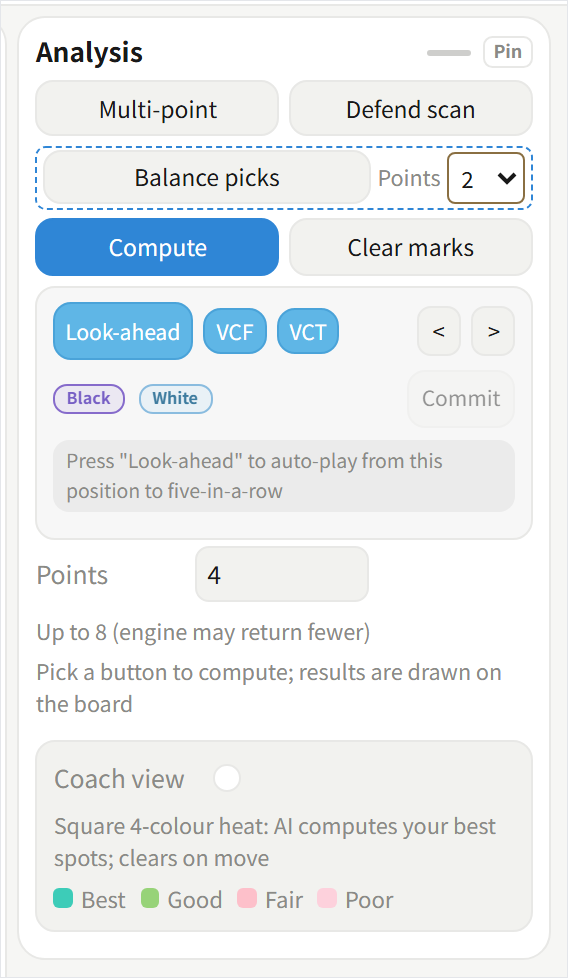
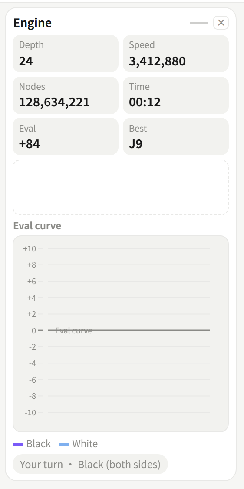
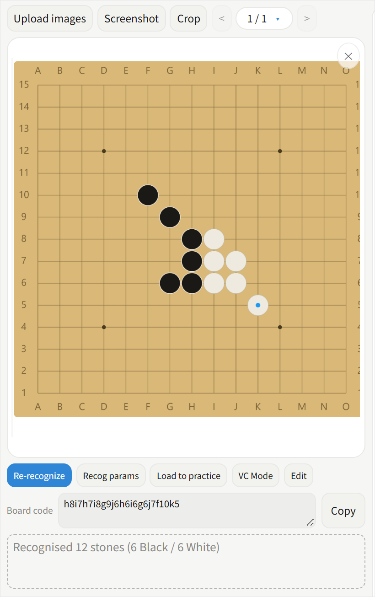
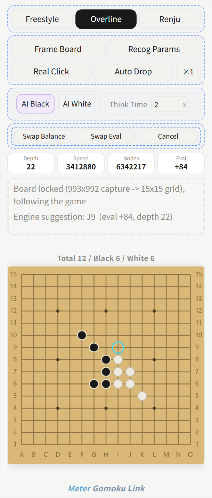
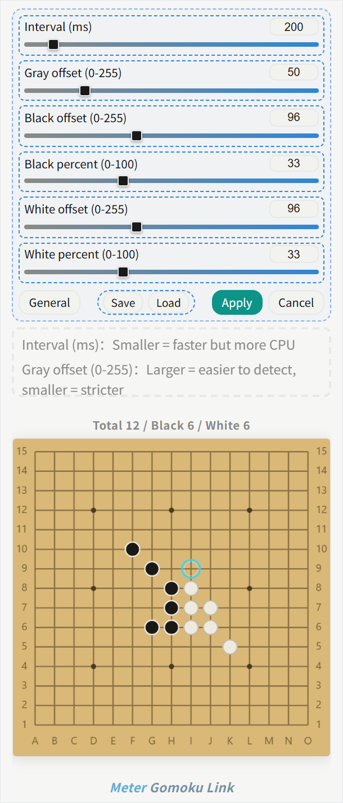

# Meter Gomoku — Line Version

**English** | [Chinese](README_zh.md)

A Windows desktop assistant for Gomoku / Renju. It **reads the board you are already playing on** — any third-party client, web board or emulator — keeps a mirror of the position, asks the bundled Rapfi engine for the best move, and can play it for you. This repository is the **Line (screen-recognition) version**: screen capture + always-on-top overlay + simulated clicks. It is not a stand-alone trainer.



> 📄 **Printable bilingual manual (PDF, 48 pages):** [docs/Meter-Gomoku-Manual.pdf](docs/Meter-Gomoku-Manual.pdf)

---

## 1. What makes it different

| | |
|---|---|
| **Works with any client** | No hooks, no DLL injection, no memory reading. It only takes screenshots and simulates clicks, so it does not touch the other program's internals. |
| **Locked-geometry recognition** | The 15×15 grid is located once and then **locked**; afterwards only changed intersections are re-read (a still picture costs almost nothing, one stone costs one cell). |
| **Always-on-top link window** | A fixed 304×712 window that never gets covered by the game window, with its own control panel, status line and mirror board. |
| **Real engine** | Rapfi (GPL-3.0), shipped as separate processes in four instruction-set variants; the main lane owns the whole transposition table. |
| **Official balance tools** | Balance search uses the engine's native paired `YXBALANCETWO` search, and swap openings come from the official opening book — not from a hand-made table. |
| **Nothing to install at runtime** | No Python, no Node, no extra DLLs. WebView2 is the only runtime dependency (built into Windows 11). |

---

## 2. Quick start

1. Run `Release/Meter Gomoku_Setup4.42.exe` and finish the installer.
2. Start the app, then open your Gomoku client (or a web board) and get to the game screen.
3. In the main window click **Link** in the top bar — a small window appears.
4. Click **Frame Board** and drag a rectangle around the board *including its outer border*.
5. Choose **AI Black / AI White** (the side the engine plays), the rule and the thinking time, then switch on **Auto Drop**.

The mirror board in the link window starts following the game immediately. If your client ignores simulated clicks, turn on **Real Click** (it borrows the physical cursor — see §5).

---

## 3. Main window


| Area | What is there |
|---|---|
| **Top bar** | Link (opens the link window) · Recognition (screen recognition) · Review · History · About · Language (toggles the UI between English and Chinese) · Palette |
| **Left dock** | Engine dashboard (depth / speed / nodes / time / eval / best move) and the evaluation curve (black and white series, vertical axis auto-scales to about ±1200) |
| **Board** | 15×15 board with coordinates on all four sides and a continue/pause key in the middle. Analysis marks are drawn straight on it |
| **Right dock** | Cards: Game setup, Calculation & evaluation, Engine dashboard. Drag by the title bar to reorder, fold with the small dash, close with ✕. The layout is remembered |
| **Bottom bar** | Live analysis · ◀ ▶ (step through moves) · Restart · Save position · undo / redo / swap colours · AI side (popover) · Settings (add a card) |

### Game setup



* **Mode** — Play · Place stones · Endgame problem.
* **AI side** — Black / White; both switches off means you play both sides.
* **Think time** — 0.2 s to 300 s. The same value is used by the link window; the two are always in step.
* **Rule** — Freestyle · Overline (a six-in-a-row does not win) · Renju (forbidden moves).
* **Engine** — thread count and hash size. The maximum thread count is chosen from the real topology (physical cores minus two, so recognition and the system keep breathing room); hash is memory-adaptive. Both are persisted, so the next launch starts where you left off.
* **Board display** — move numbers on stones, hover preview box.
* **Position code** — copy / paste / load the whole position as one string.

### Calculation & evaluation



| Function | What it does |
|---|---|
| **Calc** | One deep search of the current position; the best point is marked on the board. The key toggles to Stop |
| **Multi-point** | Returns *N* candidates (2–8, default 4); each ring carries its rank and score |
| **Balance** | Runs the engine's native **paired** balance search and returns points where neither side has a clear edge, together with the balance engine's own score. `\|eval\| ≤ 50` is what counts as balanced (ScalingFactor = 200, so win rate = sigmoid(eval/200)) |
| **Points** | How many balance points to return (1–6). An empty board is fixed at 3 — Black 1 at the centre, White 2 and Black 3 given jointly by one paired search |
| **Defend scan** | Scores every empty point in a 9×9 neighbourhood: **W = moves to win, L = moves to lose**, badge colour runs from teal (safe) to red (dangerous). Re-scans automatically after each move |
| **Lookahead, VCF, VCT** | Forced-line tools. Lookahead plays the position forward until five in a row actually appears; VCF only uses consecutive fours; VCT adds live threes |
| **Coach** | Four-colour square hints while it is your turn (best / good / fair / poor); they vanish when you move |
| **Live analysis** | Keeps deepening in the background and lays out the engine's current list; your move or undo restarts the session |
| **Clear marks** | Erases every mark this card leaves on the board, without touching the position |

### Engine dashboard



`Depth` · `Speed` (nodes/s) · `Nodes` · `Time` (accumulates across turns in live analysis) · `Eval` (positive = good for the side to move) · `Best`. All of them update while any calculation is running, which makes it the quickest way to see whether the engine is actually working.

---

## 4. Screen recognition



Open it from **Recognition** in the top bar. It turns a screenshot into a position code.

1. **Upload** (multi-select, up to 150) or **Screenshot** to capture a region.
2. **Crop** — the crop box snaps to the board and leaves about 1/30 of the board as margin, so the outermost stone stays complete.
3. **Recognize** — the result becomes a position code that can be copied, or loaded straight into practice.
4. **Edit** — swap Black and White (click one of each), delete stones, add Black or White stones; `Ctrl+Z` undoes.
5. **VC mode** — for mate problems: Black and White counts may differ, adding stones is unlimited, and loading it switches to Endgame mode with the attacking side preset.

**Recog Params** lays six thresholds directly on the panel and applies them while you drag:

| Parameter | Meaning |
|---|---|
| Sync interval (ms) | How often stones are re-read. Smaller is more responsive, but costs more CPU |
| Grey offset (0–255) | The grey threshold for "there is a stone here" |
| Black offset / Black percent | Grey threshold and in-cell coverage for Black. Too many Black stones → lower; missing → raise |
| White offset / White percent | The same two values for White |

### How the recognition works

* **Two-stage fusion** — the first frame is pinned down by the app's own detector, which also reports the exact position of all 15 horizontal and 15 vertical lines. Once locked, the engine's synchronous stone reader takes over and the window fingerprint is handed across, so the full search happens exactly once.
* **Cell-by-cell change detection** — every intersection keeps a 6×6 sample signature, so a still picture re-reads zero cells and a single stone re-reads exactly one.
* **Image tolerance** — when the whole board reads empty, the thresholds are relaxed once against this frame's own peak; if it is still empty, a *local-contrast* reader takes over (it compares each intersection's centre patch with the diagonal patches around it, so dark and washed-out boards behave the same). If the grid does not line up with the lines, an older projector-based recogniser re-checks and the more plausible result wins. A whole row of 15 stones — impossible in Gomoku — is treated as a one-cell misalignment and re-read after shifting the grid.
* **Capture protection** — every mark the app draws is excluded from screen capture, so the assistant can never misread its own overlay as stones.

---

## 5. Link mode



The link window is a separate top-level window, 304×712, always on top. It does *all* of the recognition and all of the AI work; the main window only mirrors the position.

| Control | What it does |
|---|---|
| **Rule buttons** | Freestyle / Overline / Renju — switches the endgame and forbidden-move rules used by the link window |
| **Frame Board** | Drag a rectangle over the board on screen; recognition starts once the frame is set |
| **Recog Params** | Swaps the button area for the six thresholds, applied live (see §6) |
| **Real Click** | Uses the physical mouse cursor. **Off by default** — only needed for clients that accept nothing but real mouse input. While on it takes over your cursor |
| **Auto Drop** | Thinks as soon as the opponent's move is seen and plays for you |
| **×1 / ×2 / ×3** | Clicks per move |
| **AI Black / AI White** | Mutually exclusive; the choice is mirrored into the main window immediately |
| **Think time** | 0.2–300 s, one shared value |
| **Swap Balance** | Opening balance points (see below) |
| **Swap Eval** | Independent of the above: scores the current swap position with the *playing* engine, to help you decide whether swapping is worth it |
| **Cancel** | Stops an in-flight balance / evaluation and clears the marks already drawn |

### Status area

`Depth` · `Speed` · `Nodes` · `Eval` update live; below them a fixed-height dashed text box explains what is happening (recognising / thinking / balance points marked …). The mini board on the right mirrors the recognised position and shows the stone count — it keeps the last good position when a frame reads nothing, instead of clearing itself.

### Auto Drop: the three-stage pipeline

| Stage | Method | When |
|---|---|---|
| 1 | `PostMessage` straight to the target window | Default: lightest, never disturbs the physical mouse |
| 2 | `SendInput` | Escalated automatically when the next frame says stage 1 failed |
| 3 | `SetCursorPos` + `mouse_event` (a real click) | Last resort; once it works it is pinned and reused |

Every stage is judged by the following frame. If all three fail, a whole round restarts automatically — up to three rounds, then it stops and tells you. A finished game switches Auto Drop off, so the next game starts clean.

### Swap Balance

On an **empty board** the app uses the official opening book: the engine returns a three-stone opening for the current rule (Swap2 book for freestyle, RIF book for Renju), which is then expanded through the board's eight symmetries and de-duplicated. The balance engine scores the pair, and that score is the number you can check.

| Stones on board | Points | Colours | Notes |
|---|---|---|---|
| 0 (empty) | 3 | 2 Black, 1 White | Black 1 fixed at the centre; White 2 / Black 3 from the official book |
| 3 stones (5 moves) | 2 | 1 Black, 1 White | One **paired** balance search returns both points together |
| More than 5 stones | — | — | Past the swap window; the app says so |

Marks live inside the recognition frame: blue/purple rings with a number for the order of play, and they disappear once you have played those stones. Pressing **Swap Balance** cancels any selected AI side (they would interfere); if Auto Drop is on, the points are played in order automatically.

---

## 6. Recognition parameters in the link window



One click replaces the button area with the six thresholds; the statistics row folds away and the text box below explains each parameter.

* Dragging or typing applies the value **immediately** and also saves it, so the next launch remembers it.
* **General** loads the defaults (200 / 50 / 96 / 33 / 96 / 33) — good for most boards.
* **Save** and **Load** store the six values under a name (up to 50 presets, drawer with Load / All / Delete / Undo).
* **Apply** saves and folds the panel; **Cancel** restores the values that were last applied, in the page *and* in the host.

---

## 7. Rules and forbidden moves

| Rule | Five in a row | Forbidden |
|---|---|---|
| Freestyle | Wins, overline included | none |
| Overline | Wins; **six or more in a row does not win** | none |
| Renju | Wins | overline, double-four, double-three (four-three is legal) |

---

## 8. Performance notes

* The engine runs as a **separate process** and is never pinned to specific cores — pinning it costs about 5× the nodes per second on modern hybrid CPUs.
* Recognition gets its own share of the cores and runs at high priority; it is intermittent (cell-by-cell change detection), so in practice it uses a small fraction of one core.
* The main engine lane owns the whole transposition table; helper lanes drop to a floor value, so total hash usage equals the size you selected.
* First launch defaults to the top of the thread list (12 threads / 512 MB on a 16-thread machine).

---

## 9. Frequently asked questions

| Symptom | Cause | Fix |
|---|---|---|
| The board is found but no stones appear | Frame is too tight, or the stones have very low contrast | Frame the board **with its border**, then try lower black/white offsets |
| Too many or too few stones of one colour | Thresholds not tuned for this theme | Use Recog Params: set the black/white offset for the grey threshold, percent for the in-cell coverage |
| Automatic dropping does nothing | The client only accepts real mouse input | Turn on **Real Click**; keep the window position fixed (the frame is geometry-locked) |
| The window is blank on start | Security software quarantined the UI package | Whitelist the install folder and reinstall |
| 360 / antivirus flags the installer | Unsigned executable that captures the screen | Allow it, or sign the build |
| Board mirror stops following | The board moved, or the window was resized | Click **Frame Board** again |

---

## 10. Repository layout

```
host/      Win32 C++ host: board scan, recognition IPC, engine processes,
           overlay window, simulated clicks (host.cpp, engine_host.*, appver.*)
ui/        WebView2 front-end: calc.html / calc.css / calc.js / bridge.js
vision/    screen board & stone recognition (statically linked OpenCV)
core/      legacy shared engine glue, kept for reference (not loaded by 4.42)
rapfi/     Rapfi search core + per-ISA build presets
           (upstream: dhbloo/rapfi)
Release/   pre-built installer (Meter Gomoku_Setup4.42.exe)
docs/      screenshots used by this document
```

> The `ui/` folder is a **reading snapshot** of the shipped 4.42 front-end, not a complete build tree (the engine adapter and a few helper modules are not included). Build scripts, the UI packing tool and intermediate artefacts are intentionally not part of this repository.

The installer ships the UI as a single packed container (`calc/ui.pak`, binary-encrypted), which the host decrypts in memory before handing it to WebView2 — there is no plain HTML on disk.

---

## 11. Requirements

* Windows 10 / 11 (x64)
* [WebView2 Runtime](https://developer.microsoft.com/microsoft-edge/webview2/) (already present on Windows 11)
* No Python, no Node, no separate engine install — the installer bundles the Rapfi variants (SSE / AVX2 / AVX512 / AVX-VNNI) and the network weights

---

## 12. Building from source (reference)

Toolchain: MSVC 2022 (v143), Windows 10/11 SDK, WebView2 SDK, statically linked OpenCV.

* `host/` — Win32 host project (manifest, `appver.rc`, icon resources).
* `vision/` — builds a DLL against static OpenCV; the host calls its exported functions.
* `rapfi/` — built with the CMake presets in `rapfi/`, one binary per instruction set.
* `ui/` — plain sources; the shipped build packs and encrypts them into `calc/ui.pak` with a local tool that is not part of this repository.

---

## 13. Credits & licence

* Engine: [Rapfi](https://github.com/dhbloo/rapfi) by dhbloo and contributors — the world-class Gomoku/Renju engine behind the search, the evaluation and the `YXBALANCE` opening commands. Distributed under **GPL-3.0**; see `rapfi/` for the licence text and the source.
* Vision pipeline built on **OpenCV** (Apache-2.0), statically linked.
* Document fonts: Source Han Serif / Source Han Sans, **SIL OFL 1.1**.
* Application code: provided for study and reference. Use the assistant in line with the rules of the platform you play on.
