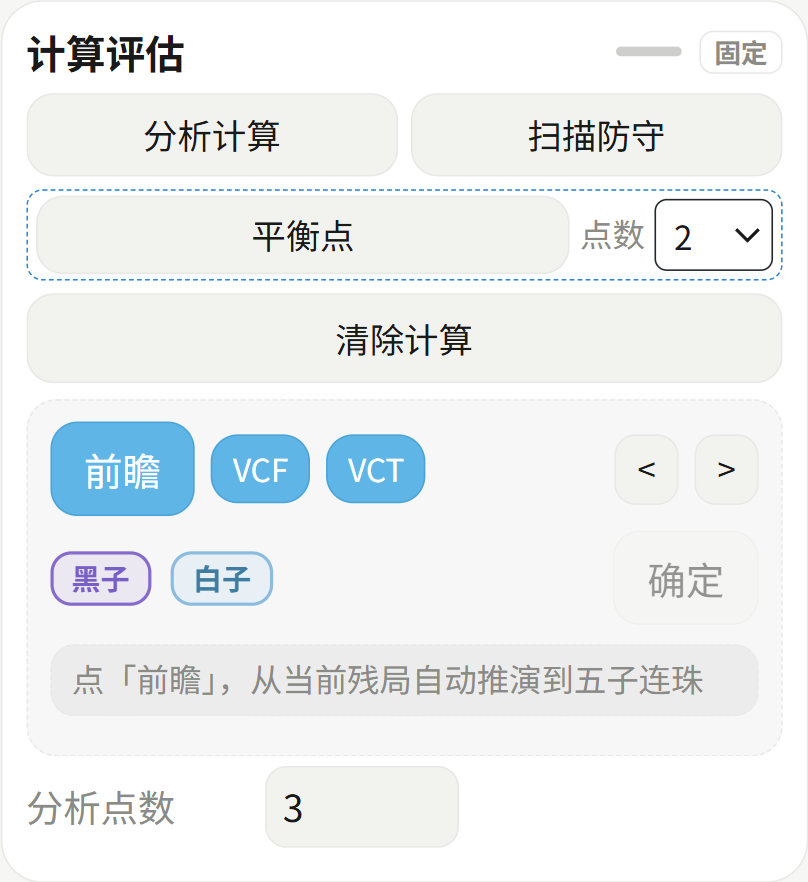
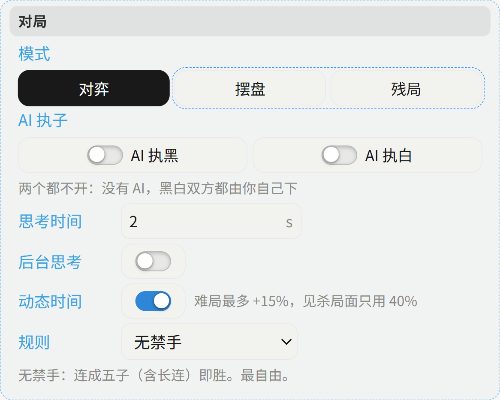
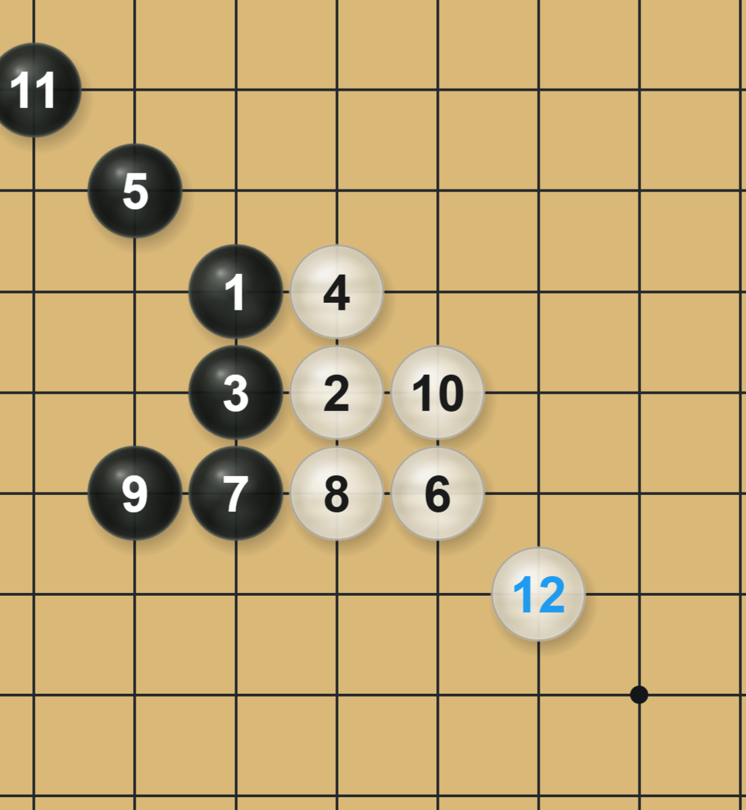
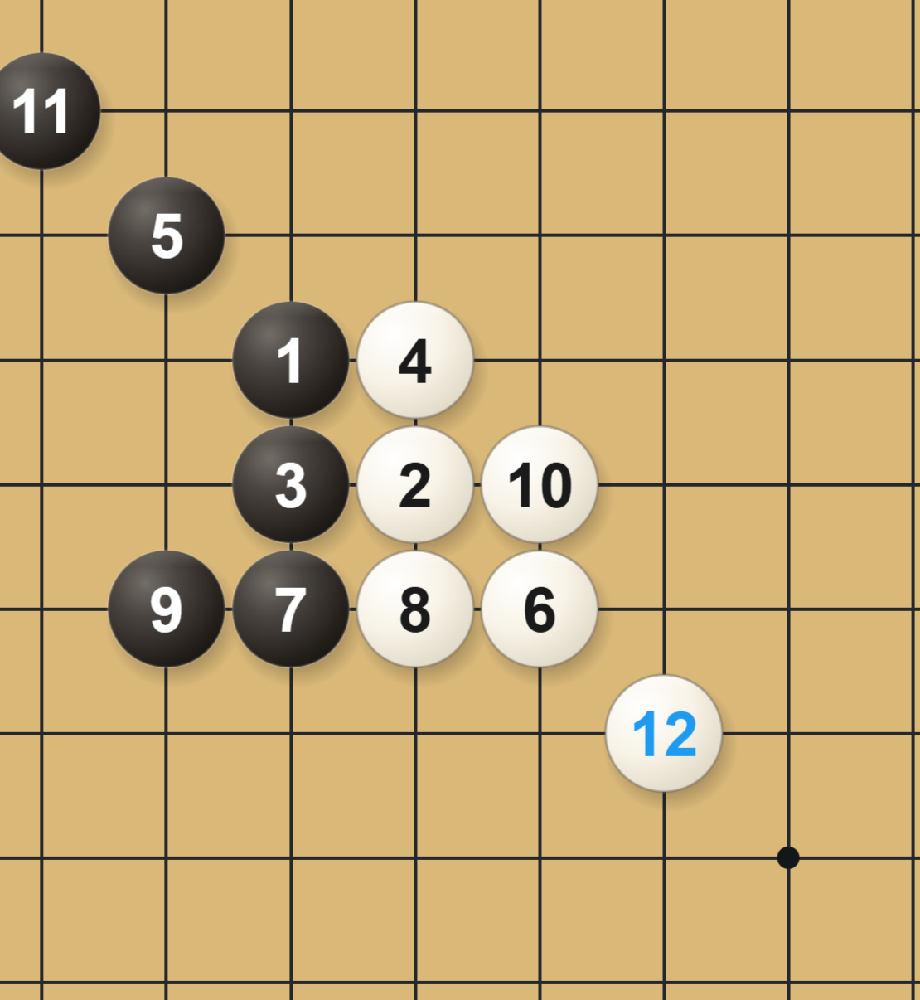
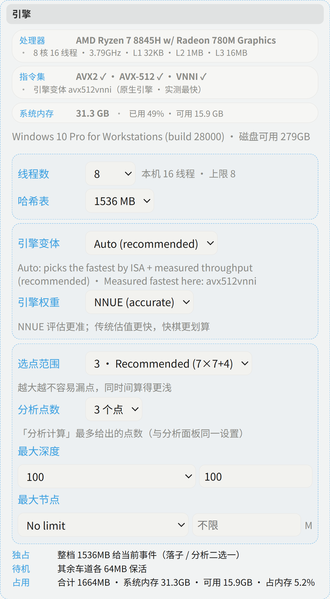
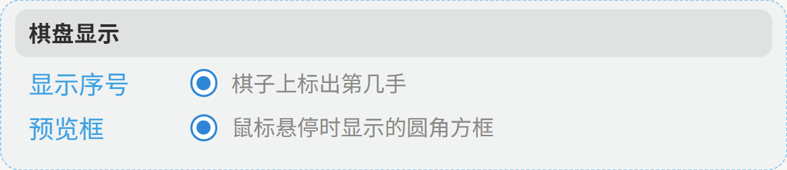
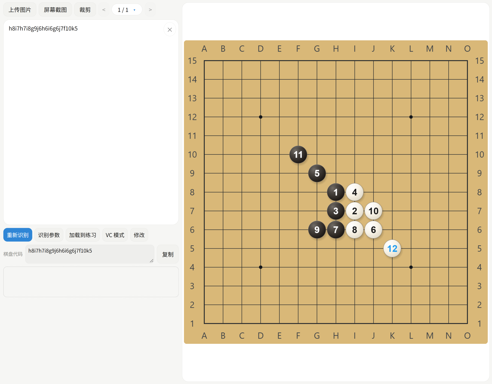
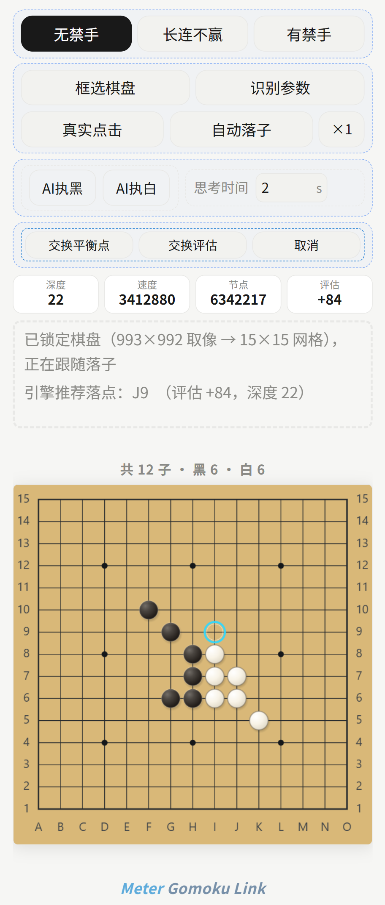
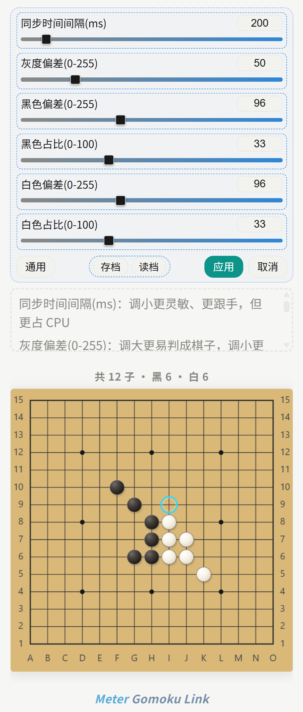

# Meter Gomoku — 连线版

[English](README.md) | **中文**

一款 Windows 平台的五子棋 / 连珠辅助工具。它**读取你正在对局的棋盘**——任意第三方客户端、网页棋盘或模拟器都行——在自己这边维护一份镜像局面，调用内置的 Rapfi 引擎算出最佳一手，并能替你落子。本仓库是**连线（识图）版**：屏幕取像 + 置顶浮窗 + 模拟点击，不是独立的练习器。

<p align="center"></p>

> 📄 **可打印的双语说明手册（PDF）：** [docs/Meter-Gomoku-Manual.pdf](docs/Meter-Gomoku-Manual.pdf)

当前版本：**4.48** · 引擎：**Rapfi 0.44.1**（发货 mix9 NNUE，源码含 mix10）

---

## 1. 它有什么不同

| | |
|---|---|
| **适配任何客户端** | 不注入、不挂钩子、不读内存。只做屏幕取像和模拟点击，完全不碰对方程序的内部。 |
| **锁定几何的识图** | 15×15 网格只定位一次随后**锁定**；之后只重读发生变化的交叉点（静止画面几乎零开销，落一子只重读一格）。 |
| **置顶连线浮窗** | 固定 304×712 的窗口，永远不被对局窗口遮住，自带控制面板、状态行和镜像棋盘。 |
| **真正的引擎** | Rapfi（GPL-3.0），以独立进程按四种指令集变体发布；主车道独占整张置换表。 |
| **官方平衡工具** | 平衡搜索直接用引擎原生的成对 `YXBALANCETWO`，交换开局取自官方开局库——不是手搓的表。 |
| **运行时零依赖** | 不需要 Python、Node 或额外 DLL。唯一的运行时依赖是 WebView2（Windows 11 自带）。 |

---

## 2. 快速开始

1. 安装 **Meter Gomoku 4.48**（从 Releases 页面下载）并完成安装。
2. 启动程序，然后打开你的五子棋客户端（或网页棋盘）并进入对局界面。
3. 在主界面顶栏点 **连线**，弹出小巧的连线浮窗。
4. 点 **框选棋盘**，在屏幕上沿棋盘**连外框一起**拖一个矩形。
5. 选择 **AI 执黑 / AI 执白**（引擎执哪一方）、规则和思考时间，然后打开 **自动落子**。

连线浮窗里的镜像棋盘会立刻开始跟随对局。如果你的客户端不认模拟点击，打开 **真实点击**。

---

## 3. 主界面

窗口分为四个区域：

| 区域 | 内容 |
|---|---|
| **顶栏** | **连线**（打开连线浮窗）· **识图**（屏幕识别）· **复盘** · **历史** · **关于** · 语言切换（EN / CN）· **颜色** |
| **左栏** | 引擎仪表盘：深度 / 速度 / 节点 / 用时 / 评估 / 最佳手，评估曲线，以及黑方/白方的分数与胜率 |
| **棋盘** | 15×15 棋盘，四边都带坐标；分析标记直接画在棋盘上 |
| **右栏** | 卡片：**对局设置**、**计算评估**、**引擎**。拖标题栏可排序，点短横折叠，点 ✕ 关闭；布局会被记住 |
| **底栏** | 分析计算 · ◀ ▶（逐步回退）· 重新开始 · 保存局面 · 撤销 / 重做 / 交换颜色 · AI 执子 · 设置（添加卡片） |

### 3.1 引擎仪表盘

<table>
<tr>
<td width="34%" valign="top"></td>
<td valign="top">
判断引擎是否真的在干活，看这里最快——只要有任何计算在跑，每个数值都会实时刷新。
<ul>
<li><b>深度</b> — 当前搜索深度。</li>
<li><b>速度</b> — 每秒节点数。</li>
<li><b>节点</b> — 本回合已搜索的节点数。</li>
<li><b>用时</b> — 已用搜索时间（实时分析中会累加）。</li>
<li><b>评估</b> — 局面评分；正数表示对行棋方有利。</li>
<li><b>最佳</b> — 引擎选出的落点。</li>
<li><b>评估曲线</b> — 评分随深度的变化，纵轴自动缩放。</li>
<li><b>黑方 / 白方 — 分数 · 胜率</b> — 各方分数及其隐含胜率。</li>
</ul>
</td>
</tr>
</table>

### 3.2 计算评估

<table>
<tr>
<td width="34%" valign="top"></td>
<td valign="top">
<ul>
<li><b>计算</b> — 对当前局面做一次深搜，最佳点标在棋盘上；按钮会切换为 <b>停止</b>。</li>
<li><b>多点分析</b> — 返回 <i>N</i> 个候选点（1–8，默认 3；与「对局设置」里的<b>分析点数</b>同一个值）；每个圈带序号和评分。</li>
<li><b>平衡点</b> + <b>点数</b> — 引擎原生的成对平衡搜索，返回双方都没有明显优势的点（<code>|评估| ≤ 50</code> 才算平）。<b>点数</b>控制返回几个（1–6）；空盘固定为 3。</li>
<li><b>扫描防守</b> — 对 9×9 邻域内每个空点打分：<b>W</b>＝几步能赢，<b>L</b>＝几步会输；每落一子自动重扫。</li>
<li><b>前瞻 · VCF · VCT</b> — 强制线工具。前瞻会把局面一直推进到真正出现五连；VCF 只用连续冲四；VCT 再加入活三。</li>
<li><b>黑子 / 白子 + 确定</b> — 提交推荐线时使用的颜色与确认键。</li>
<li><b>指导视图</b> — 轮到你走时给出四色方块提示（最佳 / 良好 / 一般 / 劣势）；落子即消失。</li>
<li><b>清除计算</b> — 抹掉本卡在棋盘上的所有标记，不动局面。</li>
</ul>
</td>
</tr>
</table>

### 3.3 对局设置

这张卡分三个板块，下面逐块配图说明。

#### 3.3.1 对局

<table>
<tr>
<td width="30%" valign="top"></td>
<td valign="top">
<ul>
<li><b>模式</b> — <i>对局</i> · <i>自由摆子</i> · <i>残局</i>（杀棋题）。</li>
<li><b>AI 执子</b> — 黑 / 白两个开关；都关掉表示你同时执两方。</li>
<li><b>思考时间</b> — 0.2–300 秒。与连线浮窗共用同一个值，两边永远同步。</li>
<li><b>后台思考</b> — 4.46 改用引擎原生 <b>pondering</b>：开着时对手思考期间引擎就在算你的应对；关着时引擎落子后立刻停，不再空转。默认关闭。</li>
<li><b>动态时间</b> — 4.48 新增。不再每手固定秒数，而是按局面难易分配，判断依据全部来自引擎上一手自己的输出：已见杀 <i>0.40×</i>、胜负已分 <i>0.70×</i>、明显优势或首选着法已收敛 <i>0.85×</i>、均势且着法还在变 <i>1.15×</i>。省下的秒数进「时间池」，难局面从池里借（上下限 −1×N ～ +2×N，不会滚雪球）。关掉即回到每手严格 N 秒。</li>
<li><b>规则</b> — 无禁手 · 长连不算赢 · 连珠禁手。</li>
</ul>
</td>
</tr>
</table>

<p align="center">
   &nbsp;&nbsp;
  <br>
  <i>同一局面下的两张棋子材质：<b>玉石</b>（左）与 <b>仿真</b>（右），均为 3 倍渲染。</i>
</p>


#### 3.3.2 引擎

<table>
<tr>
<td width="30%" valign="top"></td>
<td valign="top">
<ul>
<li><b>线程</b> — 上限按真实拓扑算（物理核减二）；<b>哈希</b>按内存自适应。两者都会持久化。</li>
<li><b>引擎变体</b> — <i>自动（推荐）</i>按实测吞吐从各指令集构建里挑最快的二进制；4.46 修掉了会把 AVX2 误判为最快的自动基准。</li>
<li><b>权重</b> — <i>NNUE（精确）</i>棋力优先，或 <i>classical</i> 在快棋里更快。</li>
<li><b>选点范围</b> — 也就是引擎的 <code>CAUTION_FACTOR</code>，六档：0 最激进（5×5 范围）… 5 最谨慎（全盘），默认 3（7×7+4，官方推荐档）。</li>
<li><b>分析点数</b> — 1–8，默认 3；与多主变（Multi-PV）和「计算评估」卡共用同一个值。</li>
<li><b>最大深度 / 最大节点</b> — 可选硬上限；保持默认即不限制搜索。</li>
<li>Active / Idle / Usage 一行显示主车道与辅助车道的哈希分配。</li>
</ul>
</td>
</tr>
</table>

#### 3.3.3 棋盘显示与局面

<table>
<tr>
<td width="30%" valign="top"></td>
<td valign="top">
<ul>
<li><b>手数</b> — 在每颗棋子上标出手数。</li>
<li><b>悬停框</b> — 鼠标悬停棋盘时显示圆角提示框。</li>
<li><b>局面代码</b> — 把整盘局面压成一段紧凑字符串（小写列字母 + 行号，着法依次拼接；与 gomocalc.com 同格式）。<b>复制</b> / <b>粘贴</b> / <b>载入</b> 都作用在它上面。</li>
</ul>
</td>
</tr>
</table>

---

## 4. 识图

<table>
<tr>
<td width="36%" valign="top"></td>
<td valign="top">
从顶栏 <b>识图</b> 打开。它把一张截图变成局面代码。
<ol>
<li><b>上传图片</b>（可多选）或 <b>截图</b> 框选一块区域。</li>
<li><b>裁剪</b> — 裁剪框会自动吸附到棋盘，并保留约 1/30 的边距，最外圈的棋子不会被切掉。</li>
<li><b>重新识别</b> — 结果为一段局面代码，可复制，或点 <b>载入练习</b> 直接拿去练。</li>
<li><b>编辑</b> — 黑白互换、删子、加子；<code>Ctrl+Z</code> 撤销。</li>
<li><b>VC 模式</b> — 专用于杀棋题：黑白子数可以不等、加子不限，载入后切到残局模式并预设进攻方。</li>
<li><b>局面代码</b> + <b>复制</b> — 把局面压成一段紧凑字符串。</li>
</ol>
<b>识别参数</b> 把六个阈值摆到面板上，拖动时即时生效：
<ul>
<li><b>同步间隔（ms）</b> — 多久重读一次棋子；越小越跟手，但更吃 CPU。</li>
<li><b>灰度偏移</b> — 判定"这里有一颗子"的灰度阈值。</li>
<li><b>黑子偏移 / 黑子占比</b> — 黑子的灰度阈值与格内覆盖率。</li>
<li><b>白子偏移 / 白子占比</b> — 白子对应的同两个值。</li>
</ul>
</td>
</tr>
</table>

### 识别是怎么工作的

* **两级融合** — 首帧由自家检测器定型，它同时报出 15 条横线与 15 条竖线的精确位置；锁定后由同步读子器接管，并完成窗口指纹的交接，所以整盘搜索只做一次。
* **逐格变化识别** — 每个交叉点保留一个 6×6 采样签名，静止画面重读 0 格，落一子只重读 1 格。
* **4.46 参数严格生效** — 只要五项阈值里任意一项偏离默认值，就切换到严格判定，结果完全按你设的参数来；整条兜底链（松阈值重读、局部对比读子、网格复核）只在全部保持默认时才启用。
* **图片适应性** — 默认设置下整盘读成空时，先按本帧自身峰值松一次阈值；仍空则切到局部对比读子器（把每个交叉点的中心小块与四周对角小块相比）。整行 15 颗同色子——五子棋里不可能——视为整体错位一格，平移后重读。
* **取像保护** — 程序自己画的每一处标记都被排除在屏幕捕获之外，永远不会把自己的浮层误读成棋子。

---

## 5. 连线模式

<table>
<tr>
<td width="30%" valign="top"></td>
<td valign="top">
连线浮窗是一个独立的顶层窗口，<b>304×712</b>，始终置顶。它承担<i>全部</i>识别与 AI 工作；主界面只负责镜像局面。
<ul>
<li><b>无禁手 / 长连不算赢 / 连珠禁手</b> — 当前对局的规则。</li>
<li><b>框选棋盘</b> — 在屏幕上沿棋盘拖一个矩形；框好后立即开始识别。</li>
<li><b>识别参数</b> — 把按钮区换成六个阈值，实时生效（见第 6 节）。</li>
<li><b>真实点击</b> — 使用物理鼠标指针。<b>默认关闭</b>；只有那些只认真实鼠标输入的客户端才需要。</li>
<li><b>自动落子</b> — 一看到对方落子就开始思考并替你落子。</li>
<li><b>×1 / ×2 / ×3</b> — 每一手的点击次数。</li>
<li><b>AI 执黑 / AI 执白</b> — 互斥；选择立刻同步到主界面。</li>
<li><b>思考时间</b> — 0.2–300 秒，全局共用一个值。</li>
<li><b>交换平衡点</b> — 开局平衡点（见下文）。</li>
<li><b>交换评估</b> — 用当前对局引擎给交换局面打分，帮你判断交换值不值。</li>
<li><b>取消</b> — 中止进行中的平衡 / 评估，并清掉已经画出的标记。</li>
</ul>
</td>
</tr>
</table>

### 状态区

`深度` · `速度` · `节点` · `评估` 实时刷新；下方固定高度的虚线框说明当前正在做什么（识别中 / 思考中 / 已标平衡点……）。镜像棋盘显示识别到的局面与子数（**总数 / 黑 / 白**），某帧什么都没读到时保留上一次的良好局面，而不是清空。

### 自动落子：三级流水线

| 级别 | 方式 | 何时用 |
|---|---|---|
| 1 | `PostMessage` 直接投递给目标窗口 | 默认：最轻，绝不干扰物理鼠标 |
| 2 | `SendInput` | 下一帧判定第 1 级失败时自动升级 |
| 3 | `SetCursorPos` + `mouse_event`（真实点击） | 最后手段；一旦成功就锁定复用 |

每一级都由下一帧来判定。三级全失败就自动整轮重来——最多三轮，然后停下并提示。一局结束后自动落子会关闭，下一局从干净状态开始。

### 交换平衡点

**空盘**时用官方开局库：引擎按当前规则返回一个三子开局（无禁手 / 连珠各有其库），再按棋盘八种对称展开并去重。平衡引擎给这一对打分，这个分数就是你可以核对的数字。

| 盘面棋子 | 点数 | 颜色 | 说明 |
|---|---|---|---|
| 0（空盘） | 3 | 2 黑 1 白 | 黑 1 固定在星位；白 2 / 黑 3 取自官方开局库 |
| 3 子（已走 5 手） | 2 | 1 黑 1 白 | 一次**成对**平衡搜索同时返回两个点 |
| 超过 5 子 | — | — | 已过交换窗口，程序会提示 |

标记只在识别框内：蓝 / 紫色圆环加手数序号，走掉那些子后就消失。点 **交换平衡点** 会取消已选的 AI 执子（否则会互相干扰）；如果开着自动落子，这些点会按顺序自动落。

---

## 6. 连线浮窗里的识别参数

<table>
<tr>
<td width="30%" valign="top"></td>
<td valign="top">
点一下就把按钮区换成六个阈值；统计行收起，下方文本框解释每个参数。
<ul>
<li><b>间隔（ms）</b> — 默认 200。越小越快，但更吃 CPU。</li>
<li><b>灰度偏移</b> — 越大越容易检出，越小越严格。</li>
<li><b>黑子偏移 / 黑子占比</b> — 黑子的灰度阈值与格内覆盖率。</li>
<li><b>白子偏移 / 白子占比</b> — 白子的同两个值。</li>
<li>拖动或输入会<b>立即</b>生效，同时保存。4.46 起只要偏离默认值就走严格判定，结果按你的数字来，不再被兜底链改写。</li>
<li><b>通用</b> — 恢复默认（200 / 50 / 96 / 33 / 96 / 33）。</li>
<li><b>存档</b> / <b>读档</b> — 用名字保存这六个值（最多 50 组预设）。</li>
<li><b>应用</b> — 保存并收起面板；<b>取消</b>恢复上次应用的值，页面与宿主都会还原。</li>
</ul>
</td>
</tr>
</table>

---

## 7. 规则与禁手

| 规则 | 五连 | 禁手 |
|---|---|---|
| 无禁手 | 赢，长连也算 | 无 |
| 长连不算赢 | 赢；**六连及以上不算赢** | 无 |
| 连珠 | 赢 | 长连、四四、三三（四三合法） |

---

## 8. 更新说明

### 4.48

| 方面 | 变化 |
|---|---|
| **棋子材质** | 「字体 → 棋子」提供 **仿真**（默认）、**玉石**（层状浅杂色 + 玻璃光泽）、**扁平** 三档；仿真与玉石都带落盘微阴影，棋子像「坐」在棋盘上而不是贴上去。 |
| **高清棋盘** | 棋盘画布按 **2 倍超采样**渲染，棋子边缘、手数序号、网格线与坐标在任何屏幕上都不发虚；阴影改为预烘焙贴图，40 颗子整盘重绘远低于 1 ms。 |
| **动态时间** | 对局板块新增开关（见 3.3.1）：简明局面少算、难局最多 +15%、见杀局面 40%，并带一个有界时间池。关掉即严格按设定秒数。 |
| **必胜局面响应** | 修掉「算很久、进度一直停在深度 0」：找到杀棋后不再空迭代 24 次，`START_DEPTH` 续算加了三道保险（封顶 24 层、冷表不续算、短预算不续算）。 |
| **设置窗外观** | 选项标题统一天蓝色；当页面底色接近天蓝时自动转黑或纯白，不会出现蓝字压蓝底。顶部三个卡片开关新增「窗口功能卡片展示」框。 |
| **棋子行布局** | 「字体 → 棋子」一行改为固定像素、按钮组等分剩余宽度，适中 / 较大字号都不再挤出窗口；手数字号整体收小一档。 |

### 4.47

| 方面 | 变化 |
|---|---|
| **设置窗** | 成为独立主控窗：常驻置顶、固定 1:1.618 比例随屏幕自适应、启动预热、最小化进系统任务栏并有独立入口。 |
| **双向联动** | AI 执子、线程、哈希、选点范围、分析点数、主题与语言即时同步到所有窗口。 |
| **连线窗** | 打开连线窗不再改变主窗布局、也不再写独立设置存档；连线内的 AI 参数初始听主窗。 |
| **棋盘渲染** | 标线与坐标按设备像素对齐，局面代码框并入引擎仪表盘日志下方，棋子默认显示手数。 |

### 4.46

| 方面 | 变化 |
|---|---|
| **识别参数** | 真正生效：五项阈值里任意一项偏离默认就走严格判定，兜底链不再静默改写你的结果；只有全部保持默认时才启用兜底。 |
| **后台思考** | 改用引擎原生 **pondering**（与官方整合包同一套节奏）：开着时对手思考期间引擎就在算你的应对；关着时落子后立刻停，不再空转高占用 CPU。 |
| **对局设置** | 新增 **style（谨慎度 / 选点范围）** 六档（0 最激进 … 5 最谨慎，默认 3），以及 **多主变（Multi-PV）** 行（1–8，默认 3），每档带方向说明。 |
| **分析点数** | 与多主变共用同一份值、双向同步；并接通多点分析、前瞻深算（下限放到 1–2）与扫描防守的候选上限。 |
| **引擎变体** | 自动基准之前会把 AVX2 误判成最快，现在按实测 nps 选出真实最快的变体。 |
| **候选去重** | 下沉到引擎回执层，同一个点只出现一次，重复名次消失。 |
| **卡片分组** | 只有「引擎」板块（选点范围 / 分析点数 / 线程 / 哈希）用虚线框，其余板块不加框。 |
| **本地化** | 英文界面补齐全部占位符（<code>{n}</code> / <code>{p}</code> 不再原样露出）；修复日志并发写偶发丢行。 |

---

## 9. 引擎：Rapfi 0.44.1

内置引擎为 **Rapfi 0.44.1**，用 clang + LTO 编译为四种指令集变体。源码同时带 mix9 与更新的 **mix10** NNUE 架构；发货权重是 **mix9svq** 网络（`model260809.bin`），权重选择器还可切到 classical 评估换取速度。

| 方面 | 说明 |
|---|---|
| **NNUE** | 发货 **mix9**（上游 VLTC 相对 mix8：自由15 **+29 Elo**、自由20 +21、标准15 +34、连珠15 **+56**）；**mix10** 已在源码树中，补齐权重即可选用。 |
| **指令集** | 除 SSE / AVX2 / AVX512 外新增 **AVX-VNNI**、**AVX512-VNNI**；自动模式按实测吞吐挑最快。 |
| **搜索** | 搜索优化，多核扩展更好；候选去重下沉到回执层。 |
| **协议** | 支持 `SWAPABLE` 标记与原生 `YXBALANCEONE` / `YXBALANCETWO` 平衡命令，本程序直接用于交换平衡。 |
| **启动** | 启动时解压 NNUE 权重（数百毫秒）；宿主等到引擎开口后再发第一个局面。 |

本仓库 `rapfi/` 目录跟踪这份上游源码。Rapfi 以 **GPL-3.0** 发布——许可证与完整源码见 `rapfi/`。

---

## 10. 性能说明

* 引擎以**独立进程**运行，绝不绑定到具体核心——在现代混合架构 CPU 上绑核会让每秒节点数掉到约 1/5。
* 识别分到自己的一份额度并以高优先级运行；它是间歇性的（逐格变化识别），实际只占用不到一个核心的一小部分。
* 主引擎车道独占整张置换表，辅助车道降到地板值，所以总哈希占用等于你选的大小。
* 后台思考关闭时，引擎落子后不再高占用空转（4.46）。

---

## 11. 常见问题

| 现象 | 原因 | 解决 |
|---|---|---|
| 找到棋盘但没有棋子 | 框太紧，或棋子对比度太低 | **连外框一起**框棋盘，再试着调低黑白偏移 |
| 某种颜色子太多或太少 | 阈值不适配这套配色 | 用识别参数：偏移调灰度阈值，占比调格内覆盖率 |
| 自动落子没反应 | 客户端只认真实鼠标输入 | 打开 **真实点击**；保持窗口位置固定（框是几何锁定的） |
| 启动后窗口空白 | 安全软件隔离了 UI 包 | 把安装目录加白名单后重装 |
| 杀毒软件报安装包 | 未签名的屏幕捕获程序 | 允许运行，或对构建签名 |
| 镜像棋盘不再跟随 | 棋盘移动了，或窗口被缩放 | 重新点 **框选棋盘** |

---

## 12. 仓库结构

```
host/      Win32 C++ 宿主：棋盘扫描、识别 IPC、引擎进程、
           浮窗、模拟点击（host.cpp, engine_host.*, appver.*）
ui/        WebView2 前端：calc.html / calc.css / calc.js / bridge.js
vision/    屏幕棋盘与棋子识别（静态链接 OpenCV）
core/      遗留的共享引擎胶水层，仅供参照（4.46 不再加载）
rapfi/     Rapfi 0.44.1 搜索核心 + 各指令集构建预设
           （上游：dhbloo/rapfi，GPL-3.0）
docs/      本文档用到的截图与可打印手册
```

> `ui/` 目录是发货版 4.46 前端的**阅读快照**，不是完整构建树（引擎适配层与少数辅助模块未包含）。构建脚本、UI 打包工具和中间产物有意不纳入本仓库。

安装包把 UI 打成单一容器（`calc/ui.pak`，二进制加密），宿主在内存中解密后才交给 WebView2——磁盘上没有明文 HTML。

---

## 13. 运行要求

* Windows 10 / 11（x64）
* [WebView2 运行时](https://developer.microsoft.com/microsoft-edge/webview2/)（Windows 11 自带）
* 不需要 Python、Node，也不需要单独安装引擎——安装包已内置 Rapfi 各变体（SSE / AVX2 / AVX512 / AVX-VNNI）与网络权重

---

## 14. 从源码构建（参考）

工具链：MSVC 2022（v143）、Windows 10/11 SDK、WebView2 SDK、静态链接 OpenCV。

* `host/` — Win32 宿主工程（manifest、`appver.rc`、图标资源）。
* `vision/` — 针对静态 OpenCV 编译成 DLL；宿主调用其导出函数。
* `rapfi/` — 用 `rapfi/` 里的 CMake 预设构建，每种指令集一个二进制。
* `ui/` — 明文源码；发货构建用本仓库之外的本地工具把它们打包加密进 `calc/ui.pak`。

---

## 15. 致谢与许可

* 引擎：[Rapfi](https://github.com/dhbloo/rapfi)，作者 dhbloo 及贡献者——支撑搜索、评估与 `YXBALANCE` 开局命令的世界级五子棋/连珠引擎。以 **GPL-3.0** 发布；许可证与源码见 `rapfi/`。
* 识别流水线基于 **OpenCV**（Apache-2.0），静态链接。
* 文档字体：思源宋体 / 思源黑体，**SIL OFL 1.1**。
* 应用代码仅供学习参考。请在你所玩的平台规则允许的范围内使用本工具。
